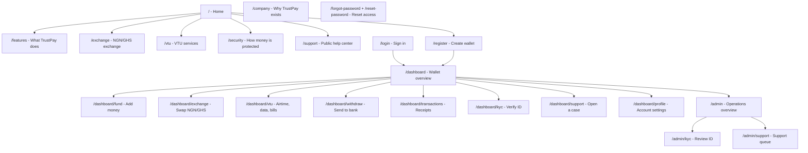

# TRUSTPAY Website UX Map

## UX Thesis

TrustPay should feel like a clear money workspace. Organize the site around the two core services users need most: exchange NGN/GHS and pay VTU services. Wallet, KYC, support, and receipts support those jobs.

Primary organizing principle: task-first for public and user pages; queue-first for admin pages.

## Grade 5 Copy Rules

- Use short verbs: swap, pay, check, track, verify.
- Name the thing users care about: wallet, rate, fee, receipt, status, limit.
- Avoid vague fintech words. Say "money", "bill", "bank", "ID", "help".
- Every money page should answer: how much, from where, to where, fee, status, next step.
- Every error should say what happened and what to do next.

## Page Map

## Core Pages And UX Aim

| Page | Main job | UX promise | Primary CTA |
| --- | --- | --- | --- |
| Home | Understand TrustPay fast | "Move money. Pay bills. Track proof." | Create wallet |
| Features | See supported jobs | "Exchange and VTU from one wallet." | Start with wallet |
| Exchange | Understand the main service | "See the rate before you approve." | Start exchange |
| VTU | Understand utility payments | "Pay airtime, data, TV, and power." | Start VTU payment |
| Security | Build trust | "Your money actions need checks." | Create account |
| Company | Explain focus | "Built for Ghana and Nigeria money jobs." | Explore product |
| Support | Find help | "Bring a reference. Get the right help." | Sign in for support |
| Register | Open account | "Create wallet and money PIN." | Create wallet |
| Login | Return safely | "Sign in and keep moving." | Sign in |
| Dashboard | See money state | "Balances, status, and next actions in one view." | Choose action |
| Fund | Add money | "Review amount and provider before redirect." | Review funding |
| Exchange | Swap currency | "See rate and amount before approval." | Create quote |
| VTU | Pay bills | "Pick service, pay, and track status." | Pay bill |
| Withdraw | Send to bank | "Resolve bank name before payout." | Review withdrawal |
| Transactions | Track proof | "Find receipt, reference, amount, and status." | Filter or retry |
| KYC | Lift limits | "Submit ID and see review state." | Submit document |
| Support Case | Ask for help | "Never share OTP or password." | Send case |
| Admin | Watch operations | "Find risk and pending work fast." | Review queues |
| Admin KYC | Review identity | "See masked ID, document, reason, decision." | Approve or reject |
| Admin Support | Resolve cases | "Use reasoned decisions and audit trail." | Update case |

## Navigation Rules

- Public nav stays small: Features, Exchange, VTU, Security, Company, Support.
- Auth actions stay separate: Sign In and Create Account.
- Dashboard nav groups frequent jobs before records: Dashboard, Fund, Withdraw, Exchange, VTU, Transactions, KYC, Support, Profile.
- Admin links only appear for admins and point to queues, not raw data dumps.
- Route labels should use plain user words: "Withdraw" instead of "Payout orchestration"; "KYC" only when paired with "Verify ID".

## Motion Rules

- Page hero: one staggered entrance for badge, title, text, and CTA.
- Sections: reveal on scroll with a short upward fade.
- Cards: 2px lift, soft border change, no large bouncing motion.
- Buttons and nav: small press movement and icon nudge.
- Status pills: subtle pulse only for pending states.
- Respect `prefers-reduced-motion`.

## Visual Asset Sources

- Home hero: Vagaro on Unsplash, mobile payment image, free under the Unsplash License.
- Exchange page and status section: Airalo on Unsplash, mobile service app image, free under the Unsplash License.
- VTU page: Airalo on Unsplash, mobile data plan image, free under the Unsplash License.

## Next UX Work

- Add visual receipts and reference copy buttons to transaction detail views.
- Add small success panels after exchange and VTU actions.
- Add better empty states for dashboard tables and admin queues.
- Add mobile viewport QA for all public, auth, dashboard, and admin pages.
